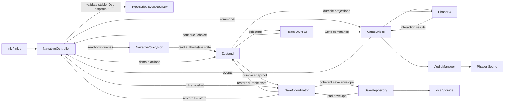

# Core Architecture

ไฟล์นี้เป็น Source of Truth ของ stack, ownership และการเชื่อมระบบ ขอบเขตผลิตภัณฑ์อยู่ใน [PROJECT.md](PROJECT.md); รายละเอียด narrative/state/UI อยู่ในเอกสารเจ้าของเรื่อง ไม่สร้าง HTTP API เพื่อเชื่อมโมดูลภายใน browser เดียวกัน

## Stack ที่ล็อกแล้ว

| ส่วน | ใช้ |
|---|---|
| DOM UI / language / build | React + TypeScript + Vite |
| Rendered world | Phaser **4** |
| Durable state | Zustand |
| Narrative | Ink + inkjs |
| Package manager | npm |
| Tests | Vitest + Playwright |
| Code quality | ESLint + Prettier |
| Persistence แรก | localStorage ผ่าน `SaveRepository` |
| Audio | Phaser Sound ผ่าน `AudioManager` |
| Deployment | Static build; Vercel และ itch.io |

Phaser major 4 เป็นข้อกำหนด ห้าม downgrade เป็น major 3 หรือใช้ตัวอย่าง API ของ major อื่นโดยไม่ตรวจ compatibility เวอร์ชัน patch/minor ของทุก dependency ยังไม่ล็อก; ดู A-01

## Ownership

| ระบบ | เป็นเจ้าของ | ขอบเขต |
|---|---|---|
| React | DOM UI | Game shell, dialogue, choices, menu, backlog, Album, settings, save/load และ fullscreen control |
| Phaser | Rendered game world | Scene, VN sprites, world layers, FX, hotspots, point-click และ puzzle presentation/interaction |
| Zustand | Authoritative durable game state | Field และ invariants ตาม [GAME_STATE](docs/GAME_STATE.md); React/Phaser อ่านผ่าน selectors และแก้ผ่าน domain actions |
| Ink/inkjs | Narrative branching/dialogue | ตำแหน่งการอ่านและ branch; ไม่เป็นเจ้าของ authoritative relationship/Promise/Memory/Album |
| `NarrativeController` | Narrative orchestration | รัน Ink, parse output และรอ choice/world event; ให้ Ink snapshot/restore ผ่าน interface ของ controller |
| TypeScript `EventRegistry` / read-only `NarrativeQueryPort` | Narrative contracts | Registry ระบุ stable Event ID/category/dispatch ไม่เป็น state store; query port อ่าน authoritative state โดยไม่เปิด mutation ให้ Ink |
| `GameBridge` | Imperative command/event boundary | ส่งคำสั่งไป Phaser และส่ง interaction result กลับ controller/app; ไม่เป็นที่เก็บ save state |
| `AudioManager` | Audio orchestration | ครอบ Phaser Sound และใช้ค่าตั้งเสียงจาก app; ไม่มีระบบเสียงอีกชุดใน React |
| `SaveCoordinator` | Save/load orchestration | รวบรวม durable snapshot จาก Zustand และ Ink snapshot ผ่าน `NarrativeController`; ประสาน validation/restore และเรียก `SaveRepository` |
| `SaveRepository` | Persistence boundary | อ่าน/เขียน snapshot ที่ผ่าน validation; ไม่มี game logic |

ลูกศร state กับคำสั่งมีหน้าที่ต่างกัน เช่น relationship เป็น state; `showCharacter`, `setExpression`, `startPuzzle`, `playSfx` เป็น command ไม่ใช้ boolean ใน store เพื่อยิง effect แล้วรีเซ็ตกลับ ตัวอย่างชื่อเมธอดเป็นการอธิบายขอบเขต **N-02 CLOSED:** Ink ส่ง stable Event ID เท่านั้น; TypeScript EventRegistry กำหนด domain/presentation dispatch ส่วน stable IDs, query port, ledger และ deterministic order ให้ยึด [NARRATIVE_SYSTEM](docs/NARRATIVE_SYSTEM.md) Actual release event/domain definitions ยังต้องมาจาก N-03/G-01

## การเชื่อมระบบ

1. UI ขอ continue/choice ผ่าน `NarrativeController` เท่านั้น
2. Controller parse และ validate output ทั้งชุดผ่าน EventRegistry ก่อน commit domain events ไป Zustand แล้ว execute presentation commands ผ่าน `GameBridge` และ publish view model ให้ React; Ink อ่าน state ผ่าน read-only query port ไม่ mirror state ทั้งก้อน
3. Phaser ส่งผล hotspot/puzzle กลับผ่าน bridge; controller ตรวจว่าเป็นผลของ interaction ที่กำลังรอ ก่อนเดิน narrative ต่อ
4. UI อ่าน view model และ selectors ไม่มี component ที่สร้าง `Story` เอง; Phaser ไม่เปิดอ่านหรือแก้ Ink โดยตรง
5. `SaveCoordinator` เป็นเจ้าของ save/load flow: ขอ durable snapshot จาก Zustand และ Ink snapshot ผ่าน `NarrativeController`, แล้วส่ง coherent envelope ให้ `SaveRepository`
6. `SaveCoordinator` snapshot เฉพาะ Safe Checkpoint ไม่ทำกลาง choice/load transaction หรือ active puzzle; ตอน load ตรวจ validation/migration/compatibility ครบก่อนเปลี่ยน live session แล้ว restore Zustand/Ink, sync queries และ reconstruct semantic world/UI; Auto/Skip off และไม่ replay durable/one-shot presentation events/SFX

รายละเอียดลำดับและ event safety อยู่ใน [NARRATIVE_SYSTEM](docs/NARRATIVE_SYSTEM.md); snapshot/checkpoint อยู่ใน [GAME_STATE](docs/GAME_STATE.md)

Lifecycle ต้องสร้าง bridge/controller/game instance อย่างมีเจ้าของชัดเจน ถอด subscriptions/listeners และ destroy Phaser เมื่อ shell ถูกทำลาย ทดสอบ mount/unmount และ development remount เพื่อไม่ให้เสียงหรือ event ซ้ำ

## Persistence และขอบเขต v1

ไม่มี backend, database, auth หรือ cloud save ใน Prototype และ Full Game v1 ใช้ `SaveCoordinator` ประสาน `SaveRepository` ซึ่ง implementation แรกคือ `LocalStorageSaveRepository`; ห้ามเรียก localStorage กระจายจาก UI/Ink/Phaser รายละเอียด slot/schema/migration อยู่ใน [GAME_STATE](docs/GAME_STATE.md)

Local-first หมายถึงเก็บใน browser ของผู้เล่น ไม่รับรองการ sync ระหว่างเครื่อง ระหว่าง Vercel/itch.io หรือคนละ origin การล้าง browser storage อาจทำให้ save หาย; ต้องตรวจความพร้อมของ storage และแจ้งเมื่อบันทึกไม่ได้

Abstraction รองรับเปลี่ยน implementation ภายหลัง แต่ไม่ได้รวม cloud implementation ในงานปัจจุบัน

**G-02/G-03 CLOSED:** Safe Checkpoint/version compatibility และ profile versus playthrough scope ให้ยึด [GAME_STATE](docs/GAME_STATE.md) Settings/read-line history เป็น global/profile; Album/Memory/permissions/backlog เป็นของ run/save ปัจจุบัน Profile read history ไม่เป็นแหล่ง narrative truth หรือ global completion system

## Placeholder-first but style-ready

M0–M1 ใช้ placeholder visuals ได้โดยไม่ทำ final visual identity แต่ React UI ต้อง style-ready: reusable components, styling แยกจาก game/narrative logic และ centralized design tokens/CSS variables หรือ abstraction เทียบเท่า หลีกเลี่ยง hardcoded one-off styles ที่เปลี่ยน identity ภายหลังยาก

Placeholder assets ใช้ semantic/stable IDs และ asset manifest เปลี่ยน final art/style ได้โดยไม่แก้ authoritative game state หรือ Ink narrative logic ห้าม Codex invent final visual direction ใน M0 รายละเอียด phase ของ layout/design foundation/artist integration/polish อยู่ใน [MASTER_PLAN](MASTER_PLAN.md) และ [UI_ASSET_SPEC](docs/UI_ASSET_SPEC.md) รอบนี้ไม่สร้าง frontend/custom skill หรือ redesign UI

## Audio

`AudioManager` ครอบคำสั่ง BGM/SFX, stop/pause/resume, volume และ mute โดยใช้ Phaser Sound เท่านั้น React settings ส่ง intention ให้ manager; world/narrative ไม่สร้าง audio instance ของตนเอง

เริ่ม/unlock audio จาก user interaction ตามข้อจำกัด browser ตรวจใน Safari/iOS และ itch.io iframe ด้วย Pause และ reduced motion ต้องทำงานร่วมกับ narrative/world ตาม [UI_ASSET_SPEC](docs/UI_ASSET_SPEC.md) การแยกช่องเสียงและค่าตั้งต้นที่ยังไม่ล็อกอยู่ใน U-03

## Display และ browser contract

Desktop/laptop first; logical viewport **1920×1080, 16:9** มือถือ landscape ใช้ composition/UI เดียวกัน มือถือ portrait แสดง rotate prompt รายละเอียด scale, layout, input และ accessibility ให้ใช้ [UI_ASSET_SPEC](docs/UI_ASSET_SPEC.md) เป็นเจ้าของ

| Platform | Support ที่ล็อก |
|---|---|
| Desktop Chrome / Edge / Firefox / Safari | Current major + previous major |
| Chrome Android / Safari iOS | Current version |

“Current” ให้อ้างวันที่ตรวจ release ไม่ใส่เลข browser ตายตัวใน design doc Playwright Chromium/Firefox/WebKit ใช้ตรวจ regression ได้ แต่ไม่แทนการตรวจจริงบน Edge, Safari หรือมือถือ รายการหลักฐานตรวจอยู่ใน [MASTER_PLAN](MASTER_PLAN.md)

## Static build / deployment

- Vite build ต้องออก `dist/index.html` และ assets ที่ host แบบ static ได้ ไม่ต้องมี server functions หรือ runtime backend
- ให้ generated asset URLs รองรับ relative base เช่น Vite `base: './'`; asset URLs ที่ประกอบเองต้องอ้าง base/manifest เดียวกัน ห้าม hardcode `/assets/...` ที่หลุดออกนอกโฟลเดอร์เกมบน itch.io
- โหลด compiled narrative/ภาพ/เสียงเป็น static resources ได้ การโหลดไฟล์ผ่าน HTTP ของ static host ไม่ใช่ HTTP API เชื่อม subsystem
- ทั้ง Vercel และ itch.io ต้องใช้ output เกมชุดเดียวกันโดยไม่ผูก logic กับ hostname หรือบริการของ host
- ZIP เกมสำหรับ itch.io ต้องมี `index.html` ที่ root และไฟล์ประกอบครบ ชื่อไฟล์และ references ต้องตรงตัวพิมพ์ใหญ่เล็ก
- ทดสอบเกมใน iframe และ fullscreen รวม resize, audio unlock, input focus และ save/load; preview บนเครื่องอย่างเดียวไม่ปิด release gate

ข้อกำหนด relative base อ้าง [Vite production build](https://vite.dev/guide/build.html#relative-base); รูปแบบ ZIP และ asset paths อ้าง [itch.io HTML5 documentation](https://itch.io/docs/creators/html5) แหล่งภายนอกใช้ตรวจเครื่องมือ ไม่เปลี่ยนการตัดสินใจผลิตภัณฑ์

## บันทึกการตัดสินใจ

| การตัดสินใจที่ล็อก | เหตุผลจากบทสนทนา |
|---|---|
| React UI + Phaser world | แยก interface ของ VN ออกจาก sprite/puzzle/point-click |
| Zustand state + GameBridge commands | ไม่ปนสถานะระยะยาวกับ effect ครั้งเดียว |
| Ink + controller | แยก branching/dialogue จาก app orchestration และ state authority |
| Local-first / no backend v1 | เกม single-player และ static distribution; persistence abstraction เผื่อเปลี่ยนภายหลัง |
| Phaser Sound | ใช้ระบบเสียงของ engine ที่เลือกผ่าน manager ลดระบบซ้ำ |
| Game viewport เดียว | Desktop first และ mobile landscape ใช้ composition เดียวกัน |

## OPEN QUESTION

**A-01 — Toolchain versions (ปิดใน M0 ก่อนล็อก dependencies):** ต้องตรวจเวอร์ชัน Node.js/npm และ minor/patch ของ React, Vite, Phaser 4, Zustand, inkjs, Vitest/Playwright, ESLint/Prettier ที่เข้ากัน รวม compiler ของ Ink บันทึกผลใน `package.json`, lockfile และ README เมื่อ scaffold แล้ว ห้ามใช้ `latest` เป็นหลักฐาน compatibility หรือเปลี่ยน major ที่ล็อกไว้เพราะ template ตั้งต้น

สถานะ M0 (2026-10-13): เลือกและ pin toolchain ใน package.json/lockfile พร้อม Node/npm ใน `.nvmrc`/engines; exact versions/compiler และเหตุผล engine/peer compatibility อยู่ [README](README.md#a-01-toolchain-baseline) ผลตรวจจริง/ข้อจำกัดให้ดู [MASTER_PLAN](MASTER_PLAN.md#บันทึกงาน-m0--2026-10-13) Node/npm install, compiler/runtime round-trip, typecheck/unit/build และ Chromium/WebKit ผ่าน แต่ Firefox เปิดไม่ได้ด้วย Windows SideBySide error จึงคง A-01 OPEN เฉพาะหลักฐาน compatibility ที่ยังไม่ครบ ไม่ downgrade Phaser หรือตัด browser contract

การเลือก patch และ runtime ที่ผ่าน compatibility check เป็นงานตรวจทางเทคนิค; ถ้าตรวจแล้วทำตาม stack/browser contract ไม่ได้ ต้องรายงานข้อขัดแย้งก่อนเปลี่ยนข้อกำหนด

ตรวจแหล่ง Phaser จาก [official release downloads](https://phaser.io/download/stable) แล้ว; ไม่ได้เลือก patch ใหม่แทนเจ้าของโปรเจกต์ในเอกสารนี้
